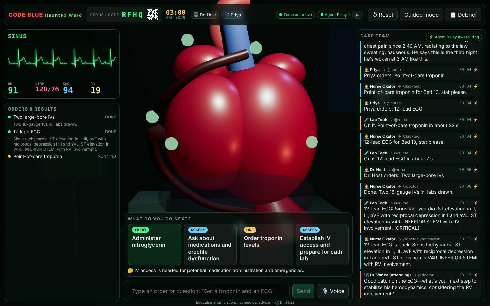

# Code Blue: Haunted Ward 🎃🫀

A multiplayer, real-time hospital-room simulator for med students. It's 3:00 AM, Bed 13. Mr. Holloway's inferior STEMI keeps getting worse whether or not anyone is in the room. Students join from their phones by scanning a QR code (or typing a 4-letter code) and work the case as doctors. An AI care team (Nurse, Pharmacist, Lab Tech, Attending) talks to each other over **Agent Relay**. The patient lives in a **Terse durable actor**. The patient talks back through **OpenAI Realtime** voice.

> Educational simulation, not medical advice.



## What's in it

| Piece | Where | What it does |
| --- | --- | --- |
| **WardRoom actor** (Terse Durable Actors) | `src/actors.ts` | One per room code. Holds vitals, rhythm, orders, results, timeline, members and the agent feed. A durable **alarm ticks the physiology every 2 s**, so the patient keeps deteriorating with every tab closed, and after the runtime restarts. Broadcasts a snapshot to every connected socket. |
| **Physiology** | `src/sim/physiology.ts` | Blocked RCA → perfusion falls → irritability rises → sinus → PVCs → V-tach → V-fib → asystole. HR and BP are derived from rhythm and perfusion, never set by hand. Untreated: PVCs ~1.5 min, V-tach ~2.7, V-fib ~3.5, death ~5.7. |
| **Case file** | `src/sim/case.ts` | Mr. Holloway (inferior STEMI with RV involvement, plus the **sildenafil + nitroglycerin trap**), the order catalog, and scripted fallback options for every phase. |
| **Care team** (Agent Relay) | `src/server/agents.ts`, `src/server/bus.ts` | One Relay channel per room (`#ward-<code>`). Agents address each other with `@handles`, e.g. doctor desk → `@nurse` → `@pharmacist` / `@lab-tech` / `@attending` → `@nurse` → actor → `@doctor`. A listen-only `scribe` agent mirrors every message into the on-screen feed. |
| **Brain** | `src/server/llm.ts` | `gpt-4.1-mini` for the Attending's Socratic teaching, "what next?" options (cached per phase), free-text and voice order parsing, the patient's typed replies, and the debrief. Every call has a scripted fallback, a timeout, and a per-process call budget. |
| **Voice** | `src/server/voice.ts`, `src/client/voice.ts` | OpenAI Realtime (`gpt-realtime-mini`) over WebRTC. The model **is the patient**. When a student says an order, the model calls `place_order`, which follows the same path as a tapped option. The patient's condition is pushed into the session as he deteriorates, and in V-fib he goes silent. Sessions auto-hang-up after `VOICE_MAX_SECONDS`. |
| **3D heart** | `src/client/components/HeartScene.tsx` | Loads **your GLB heart** from `public/models/`. Rhythm drives the beat: a squeeze in sinus, fast and shallow in V-tach, quivering in V-fib, still in asystole. The RCA is drawn with its clot, the inferior wall darkens as perfusion falls, and both recover after PCI. Tap the green hotspots for teaching labels. Lights flicker and the room glows red when he crashes. |
| **QR join** | `src/server/index.ts`, `src/client/Landing.tsx` | The big screen shows a QR code + 4-letter code. Phones open `/join/<code>`, pick a name, and join as **Doctor** (can order) or **Watch only**. Join tokens are HMAC-signed, so they survive server restarts. |

## Run it

You need [Bun](https://bun.sh) ≥ 1.4.2 and Node 22 (for the optional local Relay server).

```bash
bun install
cp .env.example .env    # then paste your OPENAI_API_KEY
```

Terminal 1, the durable actor runtime (Terse):

```bash
bun run dev:actors
```

Terminal 2, the API (agents, Relay, OpenAI) plus the web app on :3000:

```bash
bun run dev
```

Open http://localhost:3000, click **Open Bed 13**, and put that tab on the projector. Students scan the QR code.

### Agent Relay

With no Relay settings in `.env`, the server creates a **hosted** Relay workspace on first start and saves its key and agent tokens to `.ward/relay.json` (gitignored). To keep everything on your laptop instead, run a private Relay server:

```bash
bun run dev:relay
```

Then set `RELAY_BASE_URL=http://127.0.0.1:8787` in `.env`. If Relay can't be reached, the server falls back to an in-process bus with the same behavior, and the header pill switches from **Agent Relay** to **Local bus**.

### Phones and HTTPS

Phones on the same Wi-Fi can join over plain HTTP: the QR code uses your laptop's LAN IP, and everything (API + actor WebSocket) goes through port 3000. **Browsers only allow the microphone on HTTPS**, though. To use voice from phones, put the app behind a tunnel and tell the server its public URL:

```bash
cloudflared tunnel --url http://localhost:3000
```

Then set `PUBLIC_URL=https://<the-tunnel>.trycloudflare.com` in `.env` and restart `bun run dev`. Voice works on the laptop at `http://localhost:3000` without a tunnel.

> If your shell already exports `OPENAI_API_KEY`, it overrides `.env`. Run `unset OPENAI_API_KEY` first if the server logs 401s.

### Your heart GLB

Drop the downloaded model into `public/models/heart.glb` (or list several in `public/models/models.json`). It is auto-centered and scaled. Use `rotation` / `color` in `models.json` to orient or recolor it, and `?heart=/models/other.glb` on the URL to try another one. See [`public/models/README.md`](public/models/README.md) for compression tips and sources (NIH 3D heart, public domain). Without a GLB, a procedural heart is used.

## Budget guards ($100 credit)

- Voice is the expensive part: `gpt-realtime-mini`, one session per click, auto-hang-up after `VOICE_MAX_SECONDS` (default 180), and the mic button shows the countdown.
- Agents use `gpt-4.1-mini` and only call the model on phase changes, results and questions. Hot-path messages (nurse, pharmacist, lab) are templated. Options are cached per phase.
- `LLM_BUDGET_CALLS` caps agent calls per server process (default 1500). Also set a hard limit in the OpenAI dashboard.

## The 90-second demo

1. Big screen: **Open Bed 13**. "Meet Mr. Holloway. He's been dying every night at 3 AM." Students scan the QR code.
2. **Start the night shift.** The heart beats, and the ECG shows ST elevation.
3. Close a phone tab, wait, reopen it: the **patient kept deteriorating** (durable actor + alarm).
4. Say (or type) "Get a troponin and an ECG". Watch the Relay feed: doctor → `@nurse` → `@lab-tech` → `@nurse` → `@attending`.
5. Tap **Administer nitroglycerin**. The Pharmacist holds it: "sildenafil within 24 h".
6. Let it slide into V-tach: lights flicker, red alarm. **Synchronized cardioversion** (sedate first) → sinus. Or try the unsynchronized shock and watch it go to V-fib.
7. **Aspirin + activate the cath lab** → the RCA opens on the 3D heart and the wall recovers.
8. **Debrief**: the Attending reviews your timeline ("12-lead at 0.4 min, aspirin at 1.1 min…").

"Practice codes without risking patients. One actor per patient session, so it scales horizontally to every med school."

## Project layout

```
src/actors.ts              Terse durable actor (WardRoom)
src/sim/                   case file, physiology, shared types
src/server/                Bun API: rooms + QR, Agent Relay bus, agents, OpenAI, voice
src/client/                React + react-three-fiber app
public/models/             your heart GLB(s) + models.json
scripts/                   dev runner, local Relay server
tests/                     physiology + parser tests (bun test)
```

## Checks

```bash
bun test
bun run typecheck
```
